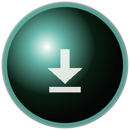

<p align="center">
  
</p>

# Nexo Torrent

<p>
  <a href="LICENSE"></a>
  
  
  <a href="#apoiar-o-projeto"></a>
</p>

Cliente BitTorrent desktop **100% open source** (licença MIT) focado em desempenho extremo pronto de fábrica: núcleo C++ **libtorrent 2.1.1**, rampa instantânea de rede e disco, interface em tema escuro **NEXO Mineral** e zero anúncios ou telemetria externa.

## Por que o Nexo Torrent entrega mais velocidade pronto de fábrica

Contra clientes tradicionais na configuração padrão de fábrica (FDM, qBittorrent padrão, uTorrent, Transmission e Deluge), o **Nexo Torrent** arranca muito mais rápido, descobre dezenas de vezes mais peers nos primeiros segundos e extrai o teto físico do protocolo sem exigir ajustes manuais em dezenas de opções ocultas:

1. **Rampa instantânea e fila profunda (`turbo_max`)**: até `500` tentativas de conexão/s, `1200` conexões globais, `smooth_connects=False`, `max_out_request_queue=2500` (`3000` entrada), buffers de socket de `4 MB`, `max_peer_recv_buffer_size=8 MB` e `tracker_backoff=100`.
2. **TCP prioritário sobre uTP (`prefer_tcp`)**: impede que o controle de latência LEDBAT do uTP estrangule downloads em redes de alta largura de banda.
3. **Filtro automático de adaptadores virtuais**: detecta e exclui interfaces não roteáveis (Hyper-V, WSL, loopback e APIPA) no modo automático, evitando anúncios mortos e redirecionando o tráfego para a placa física ou VPN selecionada.
4. **Persistência segura da tabela DHT (`dht_nodes.json`)**: salva até 200 nós IPv4 ativos e reinjeta via `add_dht_node()` após estabilizar `listen_interfaces`, preservando todas as extensões padrão (PEX, `ut_metadata`, `smart_ban`).
5. **Coalescência de disco e Smart Staging em NVMe**: habilita `coalesce_writes`, `coalesce_reads`, `piece_extent_affinity` e fila de disco de até `1024 MB` em sistemas com 24+ GB de RAM. Para downloads maiores que o limite configurável (padrão `2 GB`) destinados a HDD mecânico, grava primeiro no SSD/NVMe e move sequencialmente ao concluir.
6. **Verificação SHA paralela e Anti-Stall Endgame**: distribui o recheck em múltiplas threads (`hashing_threads` e `aio_threads`) com aceleração SHA-NI e prioriza deadlines de peças faltantes nos últimos 8% para evitar travamentos em 99%.
7. **Respeito estrito a torrents privados (BEP 27)**: bloqueia automaticamente qualquer injeção de trackers públicos quando `priv == True`.

### Transparência sobre o teto físico

Em downloads longos com muitos seeders, o limite real é sempre a banda física do seu link contratado (por exemplo, `1 Gbps` / ~`115 MB/s`) ou a soma do upload disponível no swarm: nenhum software no mundo ultrapassa a física da conexão. Um cliente avançado ajustado manualmente em dezenas de flags consegue encostar no mesmo teto de rede depois de embalado, mas o **Nexo Torrent** já entrega esse patamar pronto de fábrica e reúne, em uma única ferramenta open source, filtro automático de placas virtuais, Smart Staging em NVMe para HDD, persistência segura de DHT, Anti-Stall Endgame e diagnóstico de gargalo em tempo real.

## Benchmarks medidos

Medições executadas na suíte reproduzível em [scripts/benchmark.py](scripts/benchmark.py) (Ryzen 7 5700X3D, 32 GB RAM, NVMe + HDD, link 1 Gbps), comparando contra configurações padrão da `libtorrent` (`connection_speed=30`, `connections_limit=200`, `max_out_request_queue=500`, `hashing_threads=1`, sem boost de trackers).

### Swarm real na internet (Ubuntu 24.04.4 Desktop ISO, janela de 25s)

| Métrica | Baseline Padrão | Nexo Torrent (Cold Start) | Nexo Torrent (DHT Cache) |
| --- | --- | --- | --- |
| **Tempo até 1 MB/s** | Não atingiu | `14,56s` | **`5,55s`** |
| **Peers (5s / 15s / fim)** | `1 / 1 / 1` | `12 / 56 / 156` | **`120 / 174 / 200`** |
| **Volume baixado em 25s** | `1,0 MB` | `493,5 MB` | **`1.027,9 MB`** |
| **Velocidade média (25s)** | `0,03 MB/s` (`0,3 Mbps`) | `10,36 MB/s` (`86,9 Mbps`) | **`35,39 MB/s` (`296,9 Mbps`)** |
| **Velocidade pós-rampa (15s finais)** | `0,05 MB/s` (`0,4 Mbps`) | `17,38 MB/s` (`145,8 Mbps`) | **`52,52 MB/s` (`440,6 Mbps`)** |
| **Pico atingido** | `0,08 MB/s` (`0,6 Mbps`) | `46,19 MB/s` (`387,5 Mbps`) | **`64,51 MB/s` (`541,2 Mbps`)** |

### Motor local e verificação SHA (512 MB)

| Cenário | Baseline Padrão | Nexo Torrent (`turbo_max`) |
| --- | --- | --- |
| **Transferência local (4 seeders em NVMe)** | `21,13s` (`24,23 MB/s` / `203,3 Mbps`) | **`5,45s` (`94,00 MB/s` / `788,6 Mbps`, fila máx `14,1 MB`)** |
| **Verificação SHA (Recheck)** | `1,314s` (`389,6 MB/s`, ~`262,8s` em 100 GB) | **`0,619s` (`827,5 MB/s`, ~`123,7s` em 100 GB)** |

## Arquitetura do projeto

- `engine/`: motor C++ `libtorrent 2.1.1` (via Python 3.13) + servidor local FastAPI/WebSocket em `127.0.0.1` autenticado por token efêmero e watchdog de processo pai.
- `ui/`: interface desktop React 19 + Vite + TypeScript seguindo os tokens canônicos **NEXO Mineral** (`DM Sans`, `Sora`, `JetBrains Mono`), com gráfico de banda SVG, inspetor ao vivo, mapa de peças em Canvas e apoio via Pix offline.
- `desktop/`: shell Electron com barra integrada, bandeja do sistema, notificações nativas, captura de `magnet:` e `.torrent`, e encerramento gracioso salvando `.fastresume`.
- `scripts/`: scripts idempotentes de setup, execução, benchmark e integração reversível com o Registro do Windows (`HKCU`).

## Instalação e execução

Pré-requisitos: **Python 3.13+** e **Node.js 20+** no Windows.

1. Setup completo (venv Python, ícones Orbe NEXO Mineral, dependências da UI e Electron):
   ```powershell
   powershell -ExecutionPolicy Bypass -File .\scripts\setup.ps1
   ```
2. Iniciar aplicativo desktop:
   ```powershell
   powershell -ExecutionPolicy Bypass -File .\scripts\start.ps1
   ```
   Ou abra diretamente pelo launcher silencioso `NexoTorrent.vbs`.
3. Modo desenvolvimento (hot reload da UI + Electron):
   ```powershell
   powershell -ExecutionPolicy Bypass -File .\scripts\dev.ps1
   ```
4. Rodar suíte de testes (`pytest`):
   ```powershell
   .\engine\.venv\Scripts\python.exe -m pytest -v .\engine\tests\test_engine.py
   ```
5. Rodar suíte de benchmarks comparativos:
   ```powershell
   .\engine\.venv\Scripts\python.exe .\scripts\benchmark.py --scenarios all --size-mb 512 --live-seconds 25
   ```
   Opções: `--scenarios all|local|disk|hash|live`, `--size-mb` e `--live-seconds`. Todos os diretórios temporários são apagados automaticamente ao final.

## Integração opcional com Windows (`magnet:` e `.torrent`)

No aplicativo, acesse **Configurações > Integração Windows** para registrar ou remover os handlers em `HKCU` (sem exigir privilégios de administrador), ou execute manualmente:

```powershell
powershell -ExecutionPolicy Bypass -File .\scripts\register-handlers.ps1
powershell -ExecutionPolicy Bypass -File .\scripts\unregister-handlers.ps1
```

## Apoiar o projeto

O Nexo Torrent é 100% gratuito, open source (MIT), sem anúncios e sem telemetria. Se o projeto ajudou nos seus downloads e você quiser apoiar o desenvolvimento contínuo:


- **Chave Pix (Aleatória)**:
  ```text
  0a2a3538-4d9e-4eeb-836e-5ee6136ab7ff
  ```
- **Pix Copia e Cola (valor livre)**:
  ```text
  00020126580014br.gov.bcb.pix01360a2a3538-4d9e-4eeb-836e-5ee6136ab7ff5204000053039865802BR5912NEXO TORRENT6006BRASIL62070503***63040F5D
  ```

O app do seu banco identifica o recebedor automaticamente pela chave aleatória. Você também encontra esse QR Code offline dentro do próprio aplicativo clicando no botão **Apoiar** na barra superior. Outras formas valiosas de apoiar: deixar uma estrela no repositório, reportar gargalos com evidências de benchmark ou enviar Pull Requests seguindo [CONTRIBUTING.md](CONTRIBUTING.md).

## Licença

Distribuído sob a licença MIT. Consulte [LICENSE](LICENSE) para detalhes e [CONTRIBUTING.md](CONTRIBUTING.md) para diretrizes de contribuição.
